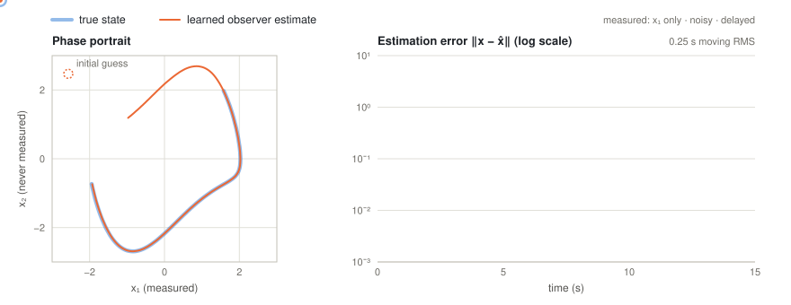
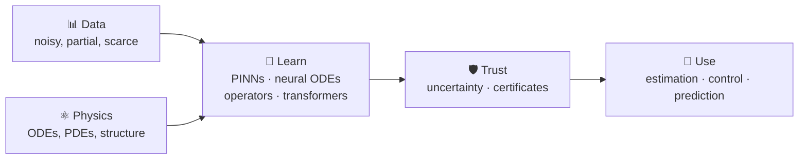

<div align="center">

# Hi, I'm Mohamed Boukaf 👋

<a href="https://github.com/mboukaf">
  
</a>


<!-- Add your links here, e.g.:
[](YOUR_SCHOLAR_URL)
[](YOUR_LINKEDIN_URL)
-->

<br/>

<picture>
  <source media="(prefers-color-scheme: dark)" srcset="assets/observer-dark.svg">
  <source media="(prefers-color-scheme: light)" srcset="assets/observer-light.svg">
  
</picture>

<sub>A neural-network observer I trained, rebuilding the full state of a Van der Pol oscillator from a single noisy, delayed measurement.</sub>

</div>

---

### 🧭 About me

I work on **scientific machine learning**: the place where neural networks meet differential equations, physical structure and real measurements.

I trained as a control engineer and then as a data scientist, and I'm now a PhD candidate at Inria / Université Paris-Saclay. I like models that learn from data but still respect the physics, say how uncertain they are, and come with a proof when it matters. My thesis is on learning-based state estimation, but that is one corner of a much wider interest.

### 🔬 What I'm curious about

<table>
<tr>
<td width="50%" valign="top">
<b>🧪 Physics-informed learning</b><br/>
PINNs, hard physical constraints, neural operators (FNO, DeepONet, PINO)
</td>
<td width="50%" valign="top">
<b>🌊 Learning dynamical systems</b><br/>
Neural ODEs, system identification, Koopman and reduced-order models
</td>
</tr>
<tr>
<td valign="top">
<b>🔁 Sequence models for dynamics</b><br/>
Transformers that learn filters in context, state-space models like Mamba
</td>
<td valign="top">
<b>🎲 Uncertainty quantification</b><br/>
Conformal prediction, Gaussian processes, Bayesian PINNs
</td>
</tr>
<tr>
<td valign="top">
<b>🛡️ Certified &amp; safe learning</b><br/>
Lyapunov, barrier and contraction certificates; Lipschitz-bounded and stable-by-design networks
</td>
<td valign="top">
<b>🌀 Generative &amp; representation learning for science</b><br/>
Diffusion over function spaces, self-supervised encoders, JEPA-style world models
</td>
</tr>
</table>

**Where I like to apply it:** 🫀 cardiovascular modeling · 🦿 neuromuscular control · 🚁 aerial robotics · 🧠 neural and chaotic oscillators

### 🗺️ How I think about SciML



### 📐 SciML in one line

```math
\min_{\theta}\;
\underbrace{\frac{1}{N}\sum_{i=1}^{N}\big\|u_\theta(x_i)-u_i\big\|^2}_{\text{fit the data}}
\;+\;\lambda\,
\underbrace{\frac{1}{M}\sum_{j=1}^{M}\big\|\mathcal{N}[u_\theta](x_j)\big\|^2}_{\text{respect the physics}}
```

The question I care about most comes after training: **how far can we trust $u_\theta$ where it never saw any data?**

### 🧰 My stack

**Languages**


| Area | Tools |
|---|---|
| **Deep learning** |     |
| **Scientific computing** |        |
| **Optimization & control** |     |
| **LLMs & data** |        |
| **Infra & workflow** |       |
| **Research & writing** |    |

**How I actually use them**
- **PyTorch + `torch.func`** (`vmap`, `jacrev`) to compute batched Jacobians, so I can train networks against conditions that hold *everywhere* in the state space, not only on average
- **CVXPY** for LMI/SDP baselines, and **Julia (JuMP + Ipopt)** for nonlinear model predictive control
- **Optuna** sweeps launched as **SLURM** jobs on HPC clusters; experiments driven by YAML configs and tested with **pytest**
- A full **RAG pipeline**: open-archive API → PostgreSQL → embeddings in ChromaDB → LangChain, evaluated with RAGAS, served with Streamlit, with the AWS infrastructure written in Terraform

### 🛠️ Things I've built

- **[PIBE](https://github.com/mboukaf/-E-PIBE)**: a physics-informed bank of estimators that recovers states, parameters and disturbances from a single noisy output *(framework presented at ECC 2026)*
- **[PigsPretraining](https://github.com/mboukaf/PigsPretraining)**: self-supervised representation learning on multichannel cardiovascular signals
- **Certified learned observers & controllers**: neural contraction metrics for estimation and trajectory tracking *(CDC 2026)*, and observers that cope with delayed measurements
- **Physics-informed cardiovascular models**: PINNs for Windkessel models of arterial blood pressure
- **KKL observers + stochastic NMPC** for neuromuscular co-contraction, in Julia
- **A research assistant for my team**: retrieval-augmented generation over our publications

### 📚 Books on my desk

- *Data-Driven Science and Engineering: Machine Learning, Dynamical Systems, and Control*, Steven L. Brunton & J. Nathan Kutz
- *Observer Design for Nonlinear Systems*, Pauline Bernard
- *Mathematical Foundations of Deep Learning: Theory and Algorithms*, Xiaojing Ye
- *The Elements of Statistical Learning*, Trevor Hastie, Robert Tibshirani & Jerome Friedman
- *Time Series with PyTorch*, Graeme Davidson & Lei Ma
- *50 ML Projects to Understand LLMs*, Mike X Cohen

### 🎓 Background

- **PhD**, Université Paris-Saclay / Inria, on learning-based observers with formal guarantees
- **MSc Data Science**, Télécom SudParis
- **Control engineering degree**, École Nationale Polytechnique (Algiers)

### 🌄 Beyond the code

- 🏃 Trail running
- 👨‍🏫 Teaching feedback control at IUT de Cachan
- 🗣️ French · English
- 💬 Always up for a chat about SciML, uncertainty and learning for control

<div align="center">
<sub>Fit the data. Respect the physics. Quantify the doubt.</sub>
</div>
